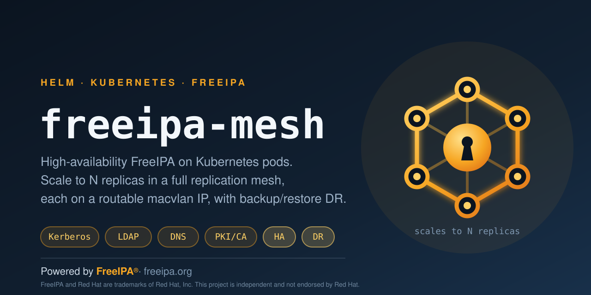
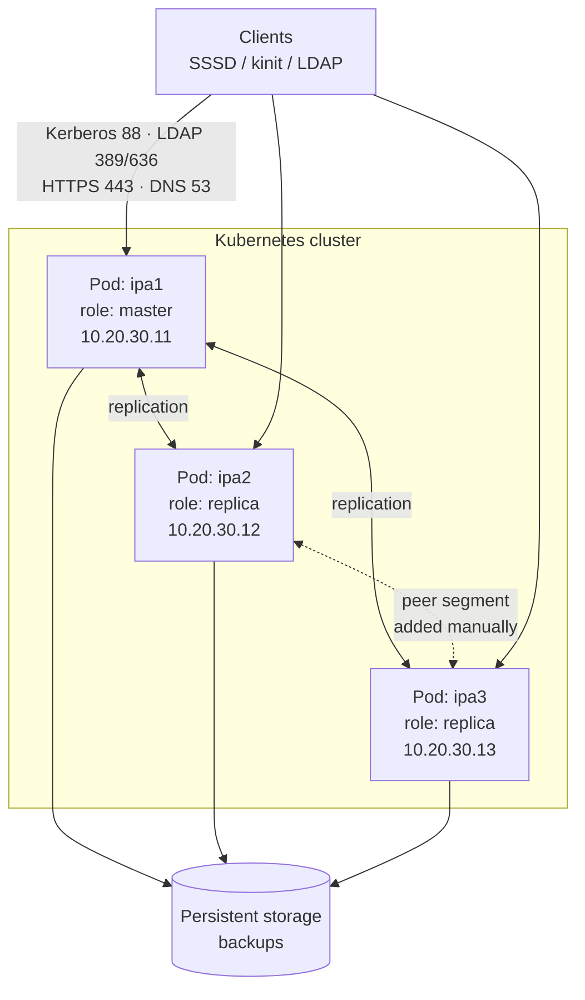

<p align="center">
  
</p>

<p align="center">
  <a href="https://www.freeipa.org/"></a>
  
  
  
</p>

# freeipa-mesh

A Helm chart that runs **high-availability [FreeIPA](https://www.freeipa.org/) on
Kubernetes pods**: an N-replica full replication mesh, each server on a real
routable address via macvlan, with scheduled `ipa-backup` and a documented
restore path for disaster recovery.

This project can implement identity management. FreeIPA does all of the
real work — Kerberos, LDAP, PKI and DNS. What lives here is the packaging,
networking and lifecycle automation needed to run it well on Kubernetes. See
[NOTICE.md](NOTICE.md) for full credits.

Disclaimer: This project was created out of necessity to easily manage an ever changing environment needing a light-weight, resilient and user-friendly LDAP, CA/PKI and DNS.

## Why this exists

FreeIPA is awkward to run on Kubernetes, for reasons that are mostly structural:

- **It is a multi-service appliance, not a process.** Kerberos KDC, 389
  Directory Server, Dogtag PKI, BIND and Apache are supervised by systemd, so
  the container runs systemd as PID 1 and the install cannot be the entrypoint.
- **Each server has an identity.** A FreeIPA server owns a host principal, a
  certificate and a set of replication agreements. Servers are not
  interchangeable, so a Deployment's rolling-replacement behaviour is actively
  harmful. This chart deploys one `Pod` per release on purpose.
- **Clients need to reach it at a stable address with working DNS.** A ClusterIP
  is not enough for machines outside the cluster, so each pod is attached to the
  physical network with macvlan and keeps a fixed IP.

Availability therefore comes from running several servers that replicate to each
other, not from rescheduling one of them.

## Architecture



Each pod attaches to the host network with macvlan, so clients reach the servers
directly rather than through a Service. One Helm release installs one server:
the master runs `ipa-server-install`, each replica waits for the master's LDAP
port and then runs `ipa-replica-install`.

Replicas replicate with the master automatically. With three or more servers,
add peer segments between the replicas so the master is not a single point of
failure — see [Completing the mesh](#completing-the-mesh).

## Requirements

| Requirement | Why |
| --- | --- |
| Kubernetes 1.21+ | Chart uses no newer APIs |
| Helm 3 or 4 | Validated against Helm 4.2 |
| [Multus CNI](https://github.com/k8snetworkplumbingwg/multus-cni) + `macvlan` plugin | Routable per-pod IPs. Not needed for the sandbox profile |
| Privileged pods permitted | systemd needs `SYS_ADMIN`, `SYS_MODULE`, `NET_ADMIN`. See [SECURITY.md](SECURITY.md) |
| A spare IP per server on one L2 segment | macvlan uses static IPAM |
| A DNS domain you control | Must not overlap the cluster's internal domain |
| ReadWriteMany storage (NFS or equivalent) | Backups, for the DR half |

## Quick start: sandbox

The fastest way to see the chart work. One pod, no macvlan, no storage, runs on
kind/minikube/k3d:

```bash
helm install sandbox charts/freeipa-mesh \
  --namespace freeipa-sandbox --create-namespace \
  --values charts/freeipa-mesh/examples/sandbox.yaml \
  --set auth.adminPassword='ChangeMe123' \
  --set auth.dmPassword='ChangeMe456'

# Installation takes several minutes. Follow it:
kubectl -n freeipa-sandbox exec sandbox-freeipa-mesh -- \
  tail -f /var/log/freeipa-install.log

# Then reach the Web UI:
kubectl -n freeipa-sandbox port-forward pod/sandbox-freeipa-mesh 8443:443
```

The pod sits in `ContainerCreating` for several minutes while packages install.
That is expected, not a hang.

> The sandbox has no persistence. The realm and its CA are destroyed with the
> pod. Do not use it for anything you intend to keep.

## Production install

### 1. Create the credentials Secret

Do this first, and keep passwords out of values files. Anything set through
`--set` or a values file is also stored in the Helm release Secret.

```bash
kubectl create namespace freeipa

kubectl -n freeipa create secret generic freeipa-auth \
  --from-literal=admin-password="$(read -rs -p 'admin: ' p && echo "$p")" \
  --from-literal=dm-password="$(read -rs -p 'dirmgr: ' p && echo "$p")"
```

Both passwords must be at least 8 characters, and they should differ.

### 2. Describe your topology once

Copy `charts/freeipa-mesh/examples/01-master.yaml`, then set `ipa.domain`, the
`network.macvlan` block, and list every server in `topology.servers`. The same
topology list goes to every release — it is how each pod learns to resolve its
peers, and how the master learns which A records to publish.

Add as many servers as you need. There is no fixed replica count.

### 3. Install the master, and wait

```bash
helm install ipa1 charts/freeipa-mesh \
  --namespace freeipa \
  --values my-values.yaml \
  --set server.role=master \
  --set server.hostname=ipa1 \
  --set server.ip=10.20.30.11
```

Wait for it to finish before adding replicas. A replica cannot join a realm
that does not exist yet.

```bash
kubectl -n freeipa exec ipa1-freeipa-mesh -- ipactl status
```

### 4. Install each replica

```bash
helm install ipa2 charts/freeipa-mesh \
  --namespace freeipa --values my-values.yaml \
  --set server.role=replica --set server.hostname=ipa2 --set server.ip=10.20.30.12

helm install ipa3 charts/freeipa-mesh \
  --namespace freeipa --values my-values.yaml \
  --set server.role=replica --set server.hostname=ipa3 --set server.ip=10.20.30.13
```

Replicas wait for the master's LDAP port before joining, so installing them
immediately is safe — they block rather than fail.

### Completing the mesh

Each replica gets a replication agreement with the master, but not with the
other replicas. Until you add peer segments, losing the master leaves the
replicas unable to replicate with each other:

```bash
kubectl -n freeipa exec -it ipa1-freeipa-mesh -- bash -c '
  echo "$IPA_ADMIN_PASSWORD" | kinit admin
  ipa topologysegment-add domain --leftnode=ipa2.ipa.example.test \
                                --rightnode=ipa3.ipa.example.test --auto
  ipa topologysegment-find domain'
```

## Disaster recovery

With `backup.enabled=true` the chart installs a root cron job that runs
`ipa-backup`, copies the result to `persistence.mountPath/backup` and prunes to
`backup.keepLast` copies.

```bash
# List what you have
kubectl -n freeipa exec ipa1-freeipa-mesh -- ls -1t /var/lib/ipa-data/backup

# Run one now
kubectl -n freeipa exec ipa1-freeipa-mesh -- /usr/local/sbin/ipa-mesh-backup

# Restore (destructive: replaces current realm data)
kubectl -n freeipa exec -it ipa1-freeipa-mesh -- \
  ipa-restore /var/lib/ipa-data/backup/ipa-full-2026-10-28-01-00-00
```

Restoring a full backup on the master requires reinitialising the replicas
afterwards with `ipa-replica-manage re-initialize --from=<master-fqdn>`.

> Verify your restores. A backup that has never been restored is a hypothesis,
> not a backup.

## Network ports

Open these between clients and every server, and between the servers:

| Port | Protocol | Service |
| --- | --- | --- |
| 80, 443 | TCP | HTTP / HTTPS — Web UI, certificate enrolment |
| 389, 636 | TCP | LDAP / LDAPS — directory and replication |
| 88, 464 | TCP + UDP | Kerberos and kpasswd |
| 53 | TCP + UDP | DNS, when `ipa.setupDNS` is true |
| 123 | UDP | NTP — Kerberos is sensitive to clock skew |

The chart does not configure a host firewall. The earlier version of the
installer ran `ufw` inside the pod, which does not work reliably in a container
and has been removed; filter at the cluster or network layer instead.

## Values reference

Everything below is overridable. Defaults use the RFC 2606 reserved domain
`example.test` and RFC 1918 addresses, so the shipped defaults cannot collide
with a real environment.

### Release and image

| Parameter | Description | Type | Default |
| --- | --- | --- | --- |
| `namespace` | Namespace to deploy into. Install with `--create-namespace`; the chart does not own the Namespace object, so several releases can share one | string | `freeipa` |
| `nameOverride` | Override the chart name used in resource names | string | `""` |
| `fullnameOverride` | Override the full generated resource name | string | `""` |
| `image.repository` | Container image. Must run systemd as PID 1 | string | `buluma/fedora-systemd` |
| `image.tag` | Image tag | string | `latest` |
| `image.pullPolicy` | Image pull policy | string | `IfNotPresent` |
| `imagePullSecrets` | Pull secrets, e.g. `[{name: creds}]` | list | `[]` |

### This server's identity

One release installs one server. For a replica, only this block changes.

| Parameter | Description | Type | Default |
| --- | --- | --- | --- |
| `server.role` | `master` runs `ipa-server-install` and becomes the first CA; `replica` runs `ipa-replica-install` and joins | string | `master` |
| `server.hostname` | Short hostname. FQDN becomes `<hostname>.<ipa.domain>`. Must appear in `topology.servers` | string | `ipa1` |
| `server.ip` | This pod's macvlan address. Required when macvlan is enabled, and must match this host's entry in `topology.servers` | string | `10.20.30.11` |

### FreeIPA realm

| Parameter | Description | Type | Default |
| --- | --- | --- | --- |
| `ipa.domain` | DNS domain for the deployment. Use a domain you control; it must not be, or contain, the cluster's internal DNS domain | string | `ipa.example.test` |
| `ipa.realm` | Kerberos realm. Defaults to the uppercased domain when empty, per FreeIPA convention | string | `""` |
| `ipa.adminUser` | Administrative account created at install | string | `admin` |
| `ipa.setupDNS` | Install and manage the integrated BIND server (`--setup-dns`) | bool | `true` |
| `ipa.dnsForwarders` | Upstream forwarders for the integrated DNS. Empty uses `--auto-forwarders` | list | `[]` |
| `ipa.extraServerInstallArgs` | Extra arguments appended to `ipa-server-install` | list | `[]` |
| `ipa.extraReplicaInstallArgs` | Extra arguments appended to `ipa-replica-install` | list | `[]` |

### Credentials

Passwords reach the pod through a Secret and are injected with `secretKeyRef`,
so they never appear in the pod spec.

| Parameter | Description | Type | Default |
| --- | --- | --- | --- |
| `auth.existingSecret` | Name of an existing Secret with both passwords. **Recommended.** When set, no Secret is created and the two password values are ignored | string | `""` |
| `auth.adminPasswordKey` | Key holding the IPA admin password | string | `admin-password` |
| `auth.dmPasswordKey` | Key holding the Directory Manager password | string | `dm-password` |
| `auth.adminPassword` | IPA admin password. Required unless `existingSecret` is set; install fails if empty. Min 8 characters | string | `""` |
| `auth.dmPassword` | Directory Manager (389-ds) password. Required unless `existingSecret` is set. Use a different value from the admin password | string | `""` |

### Replication topology

Give the same list to every release. It is used to write `/etc/hosts` in each
pod and to register replica A records in the master's zone. Add entries to grow
the mesh; exactly one entry must have `role: master`.

| Parameter | Description | Type | Default |
| --- | --- | --- | --- |
| `topology.servers` | Every server in the mesh | list | three entries |
| `topology.servers[].hostname` | Short hostname of the member | string | — |
| `topology.servers[].ip` | Static address of the member. Required when macvlan is enabled | string | — |
| `topology.servers[].role` | `master` or `replica`. Defaults to `replica` when omitted | string | `replica` |

### Resolver

| Parameter | Description | Type | Default |
| --- | --- | --- | --- |
| `resolver.nameservers` | Written to `/etc/resolv.conf` before install so the pod can reach package repositories | list | `[1.1.1.1, 9.9.9.9]` |

### Networking

| Parameter | Description | Type | Default |
| --- | --- | --- | --- |
| `network.macvlan.enabled` | Attach the pod to a macvlan network via Multus. Disable for a cluster-internal sandbox | bool | `true` |
| `network.macvlan.createAttachment` | Create a NetworkAttachmentDefinition for this release. Each release makes its own with an identical config, which avoids Helm ownership conflicts when releases share a namespace | bool | `true` |
| `network.macvlan.name` | Attachment name. Defaults to `<release>-macvlan`. Set explicitly to reference one managed elsewhere | string | `""` |
| `network.macvlan.hostInterface` | Host interface the macvlan parents to, e.g. `eth0`, `bond0`, `vlan100`. Must exist on every node the pod can land on | string | `eth0` |
| `network.macvlan.mode` | macvlan mode. `bridge` is correct for nearly all deployments | string | `bridge` |
| `network.macvlan.subnetPrefix` | CIDR prefix length of the subnet | int | `24` |
| `network.macvlan.defaultGateway` | Default gateway. Empty sets no default route | string | `10.20.30.1` |
| `podAnnotations` | Extra pod annotations. The Multus annotation is generated and need not be set | object | `{}` |
| `podLabels` | Extra pod labels | object | `{}` |

### Storage

| Parameter | Description | Type | Default |
| --- | --- | --- | --- |
| `persistence.enabled` | Mount a volume for backups and seed config. Disabling forfeits the DR half of the chart | bool | `true` |
| `persistence.mountPath` | Mount path inside the container | string | `/var/lib/ipa-data` |
| `persistence.type` | Volume source: `nfs`, `pvc`, `hostPath` or `emptyDir` | string | `nfs` |
| `persistence.nfs.server` | NFS server address. Required when type is `nfs` | string | `nfs.example.test` |
| `persistence.nfs.path` | Exported path. Required when type is `nfs` | string | `/exports/freeipa` |
| `persistence.pvc.existingClaim` | Use an existing PVC instead of creating one | string | `""` |
| `persistence.pvc.storageClass` | StorageClass for the created claim. Empty uses the cluster default | string | `""` |
| `persistence.pvc.accessModes` | Access modes for the created claim | list | `[ReadWriteOnce]` |
| `persistence.pvc.size` | Size of the created claim | string | `10Gi` |
| `persistence.hostPath.path` | Node directory when type is `hostPath`. Node-local, so pin the pod | string | `/srv/freeipa` |
| `systemd.cgroupHostPath` | Host cgroup filesystem, mounted read-only so systemd can run | string | `/sys/fs/cgroup` |

### Backup and DR

| Parameter | Description | Type | Default |
| --- | --- | --- | --- |
| `backup.enabled` | Install a cron job running `ipa-backup` and copying results to persistent storage | bool | `true` |
| `backup.schedule` | Cron schedule for the backup | string | `0 1 * * 0` |
| `backup.keepLast` | Recent backups to retain; older ones are pruned after each run | int | `5` |

### Scheduling and security

| Parameter | Description | Type | Default |
| --- | --- | --- | --- |
| `securityContext` | Container security context. FreeIPA under systemd needs these privileges; see [SECURITY.md](SECURITY.md) | object | `privileged: true` with `SYS_ADMIN`, `SYS_MODULE`, `NET_ADMIN` |
| `podSecurityContext` | Pod-level security context | object | `{}` |
| `resources.requests.memory` | Memory request | string | `2Gi` |
| `resources.requests.cpu` | CPU request | string | `1000m` |
| `resources.limits.memory` | Memory limit | string | `4Gi` |
| `resources.limits.cpu` | CPU limit | string | `2000m` |
| `nodeSelector` | Node selector | object | `{}` |
| `tolerations` | Tolerations | list | `[]` |
| `affinity` | Affinity rules. Use anti-affinity to spread servers across nodes | object | `{}` |
| `priorityClassName` | PriorityClass. Identity servers are usually worth protecting from eviction | string | `""` |

### Installer behaviour

| Parameter | Description | Type | Default |
| --- | --- | --- | --- |
| `install.logFile` | Log file for the in-container installer | string | `/var/log/freeipa-install.log` |
| `install.masterWaitTimeout` | Seconds a replica waits for the master's LDAP port before giving up | int | `900` |
| `install.upgradePackages` | Run `dnf upgrade` before installing. Slower start, current patches | bool | `true` |

## Troubleshooting

**Pod stuck in `ContainerCreating` for minutes.** Expected. Packages are being
installed and FreeIPA configured. Watch `install.logFile`.

**Pod restarts in a loop.** The `postStart` installer failed, so the kubelet
killed the container. The script is idempotent and resumes, but read the log to
find the real cause:

```bash
kubectl -n freeipa exec <pod> -- tail -50 /var/log/freeipa-install.log
```

**Replica times out waiting for the master.** The master's LDAP port is not
reachable from the replica pod. Check that the master finished installing, that
both pods are on the same L2 segment, and that `topology.servers` lists the
correct addresses.

**`helm template` fails with a message about topology.** Intentional. The chart
cross-checks `server.*` against `topology.servers` and refuses to render on a
mismatch, because that mismatch is the most common cause of a failed join.

**Install fails complaining about the hostname.** FreeIPA needs its own FQDN to
resolve. Confirm the host's entry is present in `topology.servers`.

## Repository layout

```
.
├── brand/                      logo, banner, credit badge
├── charts/freeipa-mesh/
│   ├── Chart.yaml
│   ├── values.yaml             all defaults, commented
│   ├── examples/               master, replica and sandbox profiles
│   ├── scripts/                installer, env-driven, no site values
│   └── templates/
├── NOTICE.md                   credits and trademark attribution
├── SECURITY.md                 threat model and reporting
└── CONTRIBUTING.md
```

## Before you publish this repository

- [x] Replace `USER` in `Chart.yaml` (`home`, `icon`, `sources`) with your GitHub account
- [x] Set the repository description
- [ ] Add repository topics (see [CONTRIBUTING.md](CONTRIBUTING.md) for the suggested list)
- [ ] Upload `brand/banner-freeipa-mesh.svg` under Settings → Social preview
- [ ] Confirm no real hostname, address or password remains: `git grep -nE '([0-9]{1,3}\.){3}[0-9]{1,3}'`

## Contributing

Issues and pull requests are welcome. See [CONTRIBUTING.md](CONTRIBUTING.md).

## License

[Apache License 2.0](LICENSE).

FreeIPA itself is a separate project under its own license. Red Hat and FreeIPA
are trademarks of Red Hat, Inc. This project is independent and not endorsed by
Red Hat. See [NOTICE.md](NOTICE.md).
